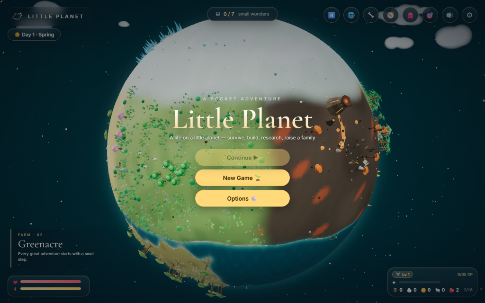
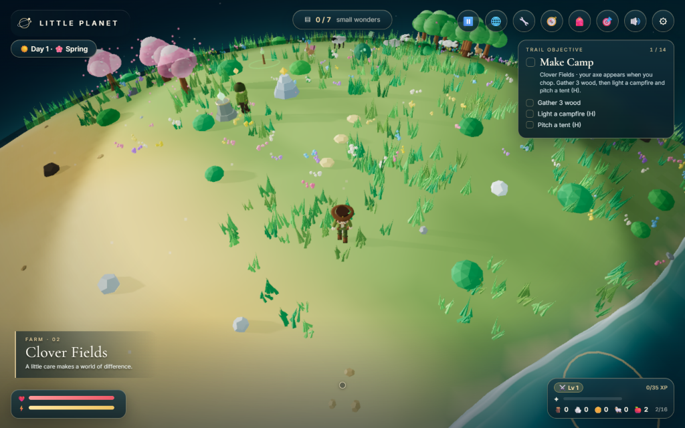
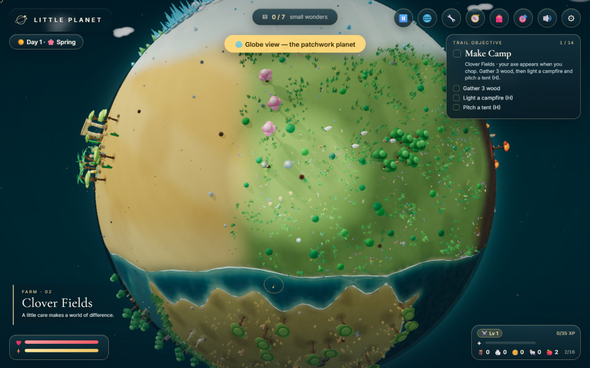
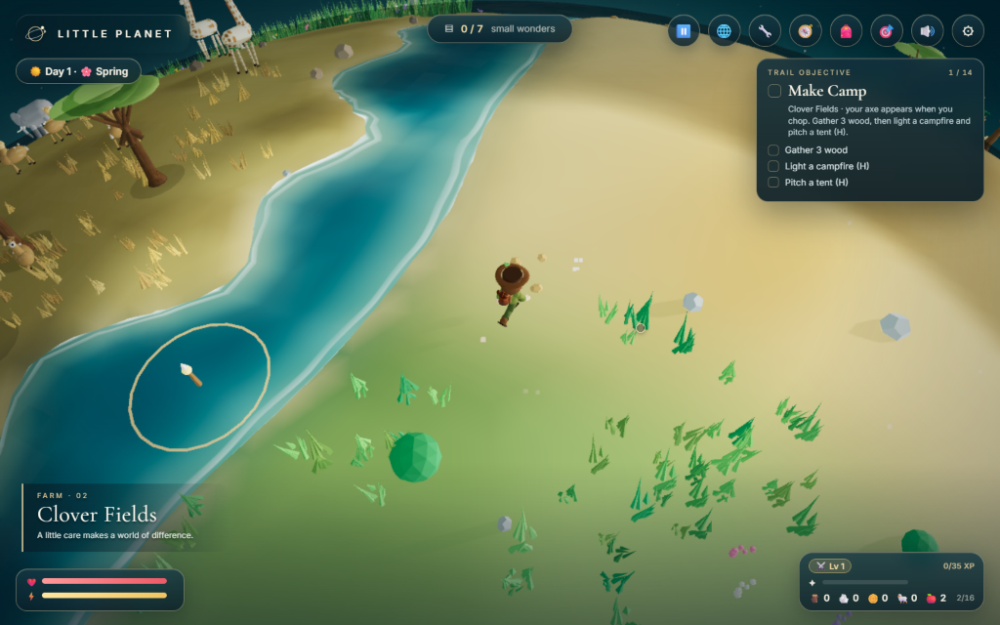
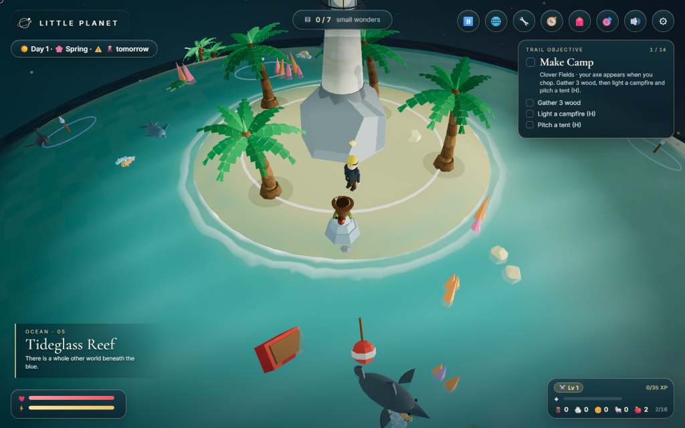

<div align="center">

# 🌍 Little Planet — A Pocket Adventure

*A charming 3D tiny-planet exploration, survival, and homesteading adventure built with Three.js — one seamless traversable sphere, 10 smooth-blended biomes, 7 Small Wonders, sailing, wildlife, and a multi-generation legacy.*

[](https://studio-9373398923-6294b.web.app)
[](https://threejs.org/)
[](https://vite.dev/)
[](#-the-10-biomes--7-small-wonders)

**[▶ Play Online Now — https://studio-9373398923-6294b.web.app](https://studio-9373398923-6294b.web.app)**

<br/>



</div>

---

**Little Planet** drops you onto a living, breathing miniature world you can walk all the way around. Start with a campfire and a stubborn heart in **Clover Fields**, sail across turquoise reefs, cross the meandering **Great River**, brave territorial apex predators in the **Golden Savannah** and **Mangrove Delta**, unlock 44 technologies from handmade stone tools to powder-era gear, and raise a homestead that passes down to your heir.

---

## 📸 Screenshots

<table>
  <tr>
    <td align="center" width="50%">
      
      <br/>
      <strong>🌱 Clover Fields &amp; Blossom Meadows</strong>
      <br/>
      <sub><em>Pip exploring rolling meadows, cherry blossoms, sheep, and smooth coastal transitions.</em></sub>
    </td>
    <td align="center" width="50%">
      
      <br/>
      <strong>🌐 Seamless Globe View</strong>
      <br/>
      <sub><em>Press <code>M</code> anytime to zoom out and admire the entire patchwork sphere.</em></sub>
    </td>
  </tr>
  <tr>
    <td align="center" width="50%">
      
      <br/>
      <strong>🐊 The Great River &amp; Golden Savannah</strong>
      <br/>
      <sub><em>Meandering riverbanks with cattail reeds, acacia trees, giraffes, and elephants across the water.</em></sub>
    </td>
    <td align="center" width="50%">
      
      <br/>
      <strong>💡 Tideglass Reef &amp; Lighthouse</strong>
      <br/>
      <sub><em>Swim or sail out to the lighthouse island surrounded by coral spires, sea turtles, and sharks.</em></sub>
    </td>
  </tr>
</table>

---

## ✨ What Makes Little Planet Special

- **🌐 One Seamless Traversable Sphere &amp; 10 Biomes** — Walk, swim, and sail around a continuous 3D globe with smooth organic biome transitions, a meandering Great River with cattail banks, Golden Savannah, Mangrove Delta, Ember Heights volcano, and Northlight aurora.
- **🧭 Playable Travelers** — Start as **Pip the Sprout Keeper** (felt hat, watering-can pack, faster crop growth &amp; repairs) or switch to **Nova the Starlight Explorer** (navy coat &amp; star lantern that wakes hidden night sparkles). Powered by Blender-authored 19-bone GLB rigs with contextual tools.
- **🏡 Homestead, Farming &amp; 44-Tech Research Tree** — Progress from a campfire and A-frame tent to half-timbered farmhouses, red barns, stone wells, windmills, sawmills, and gunsmiths across five eras: *Handmade → Copper → Iron → Mechanical → Powder*.
- **⛵ Sailing, Fishing &amp; Living Oceans** — Board your sea skiff or dock raft, trim the sail with `Q`, and fill your Fish Book across day, night, reef, and deep water while whales breach, dolphins surf, and sharks &amp; orcas patrol the deep. Rare catches trigger a tension minigame, and three legendary trophies — Golden Arapaima, Ice Sturgeon and Golden Marlin — pay gold and morale.
- **🦁 Territorial Apex Predators &amp; 10 Guarded Relics** — Lions, tigers, crocodiles, hippos, and polar bears defend their home biomes. Research spears and bows before hunting them, or claim each biome's hidden relic for instant technology shortcuts.
- **🌦️ Seasons, Hazards, Strangers &amp; Generational Legacy** — Survive dynamic weather disasters, question or welcome wandering travellers, court and marry a villager, raise children, and retire into your heir.
- **⚔️ Telegraphed Boss Combat** — Committed predator strikes paint a red ground ring. Dash through it for a **Perfect Dodge** slow-mo and guaranteed crit counter; relic guardians add pounce, lunge and frost-slam patterns.
- **📋 Daily Contracts &amp; Gathering Rhythm** — Three rotating village contracts appear on the bounty board every dawn. While chopping, tap `E` on the beat for a 2× sweet-spot burst and a rising combo.
- **🍲 Expedition Meals** — The campfire prepares day-long buffs from ingredient pairs: River Feast (+35% gather), Hunter's Stew (+15% ranged), Harvest Bowl (+1 harvest), Warm Custard (cold immunity) and Trail Stew (+10% travel).
- **🗺️ Cartography Milestones** — Chart 25/50/75/100% of the fog for permanent travel speed, sprint efficiency, spyglass zoom and a daily insight.
- **📍 Waypoints &amp; Impact Juice** — Right-click the globe (or press `P`) to pin a beacon with distance and compass direction. Heavy hits add micro hit-stop, a directional damage arrow, and soft biome music motifs.
- **🎵 100% Procedural Web Audio** — Surface-aware footsteps, swimming, rowing, axe swings, animal calls, whale song, surf, storm audio and biome motifs synthesized live with zero external audio files.

---

## 🗺️ The 10 Biomes &amp; 7 Small Wonders

| # | Biome | Small Wonder / Role | How to Awaken / Explore |
|---|---|---|---|
| 1 | **Fernwood** | 🔥 Eternal Flame | Tend the forest campfire (`E` × 3) |
| 2 | **Clover Fields** | 🌾 Bountiful Harvest | Till a homestead plot (`H`), plant, water &amp; harvest |
| 3 | **Sunstone Oasis** | ☀️ Wake the Oasis | Brush sand &amp; turn the sunstones (`E` × 3) |
| 4 | **Shell Cove** | 🔔 Ring the Bell | Ring the timber dune bell (`E`) |
| 5 | **Tideglass Reef** | 💡 Light the Lighthouse | Swim or sail to the island lighthouse (`E`) |
| 6 | **Ember Heights** | 🌋 Scan the Volcano | Stand at the crater tripod and hold still (`E`) |
| 7 | **Northlight** | 🌌 Wake the Aurora | Activate the polar stone circle (`E`) |
| 8 | **Golden Savannah** | 🦁 Southern Frontier | Acacia plains, giraffes, rhinos, elephants &amp; lions |
| 9 | **The Great River** | 🐊 Living Waterway | Meandering river dividing the south with crocs &amp; hippos |
| 10 | **Mangrove Delta** | 🐅 Tidal Rootlands | Brackish creeks, prop roots, monkeys &amp; tigers |

At **2 / 4 / 6** wonders, the three fractured landmass bridges repair. At **7 / 7**, the planet is whole.

---

## 🎮 Controls

| Key / Input | Action |
|---|---|
| `W A S D` / Click | Walk (or sail when aboard a boat) |
| `Shift` / `Q` | Run / Dash (or trim sail) |
| `Space` | Hop |
| `E` | Context interact (chop, mine, talk, board, fish, awaken wonders) |
| `E` on the beat | 2× gather sweet spot while chopping |
| `H` / `K` / `J` / `L` / `B` | Homestead Board / Workshop / Journal / Loadout / Bounty + Daily Contracts |
| `M` / `P` / `C` / `3` | Globe View / Pin Waypoint / Camera View / Carry Star Lantern |
| Mouse Drag / Wheel | Orbit &amp; zoom camera |

Deep-link straight to any world: `#clover`, `#fernwood`, `#oasis`, `#cove`, `#reef`, `#ember`, `#north`.

---

## 🚀 Play Locally, Develop &amp; Deploy

- **Play Online:** **https://studio-9373398923-6294b.web.app**
- **Easiest Locally (Windows):** Double-click **`Play Little Planet.bat`** — installs, builds, and launches automatically.
- **Standalone Bundle:** Open **`dist/index.html`** directly in any modern browser (self-contained single-file build).
- **Dev Server:**
  ```bash
  npm install
  npm run dev
  ```
- **Build &amp; Deploy (Firebase Hosting):**
  ```bash
  npm run build
  firebase deploy --only hosting --project studio-9373398923-6294b
  ```

---

## 📁 Project Structure

- [`index.html`](index.html) — Minimalist HUD (wonder tracker, biome banner, inventory, `[E]` prompt, modals)
- [`src/main.js`](src/main.js) — Spherical terrain, smooth biome blending, 3D models, shaders, gameplay loop &amp; Web Audio synth
- [`src/style.css`](src/style.css) — Dark-pill UI &amp; typography
- [`src/assets/`](src/assets) — Blender-authored GLB hero rigs (`pip.glb`, `nova.glb`)
- [`dist/index.html`](dist/index.html) — Production single-file bundle served by Firebase Hosting
- [`docs/screenshots/`](docs/screenshots) — Showcase screenshots for this README
- [`mcp/`](mcp/README.md) — Optional stdio MCP server for browser playtesting
